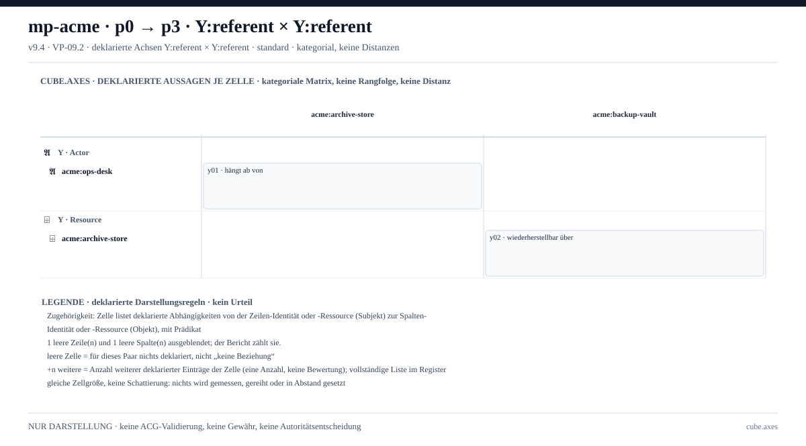

> **Scope-Aktualisierung:** Die nachfolgenden technischen Befunde bleiben gültig. Das ursprünglich daraus abgeleitete Integrationsziel wurde auf einen gezielten [Lernvergleich](LERNVERGLEICH.md) eingegrenzt; die breite Umsetzung bleibt nur [XXL-Referenz](XXL-REFERENZ.md).

# Cube-Interoperabilität: erste interne Analyse

Stand: **1. November 2026** · Zielentscheidung des Nutzers: **breite Interoperabilität aller fünf Ansätze**.

Diese Analyse ergänzt die [Research-Baseline](HANDOVER.md) durch Lektüre der drei lokalen Repositories, die vorhandene Library-Verifikation und gezielte Aufrufe des lokalen Cube-MCP. Sie ist eine belastbare Bestandsaufnahme für die [grobe Roadmap](README.md), keine vollständige Normkonformitätsprüfung oder Freigabe zur Implementierung.

## 1. Ergebnis

Die Ausgangslage ist deutlich weiter als in der Public-only-Analyse erkennbar: Es gibt eine eigenständige Function Library, deklarative P1-Profile bis P1.11 und überprüfbare P2-Projektionen. Die wesentliche noch offene Arbeit liegt bei versionierten Fremdprofilen, expliziten Abbildungsregeln, Austauschformaten und fachlichen Konformitätsfällen.

**Eine neue morphologische Kategorie ist durch diese Untersuchung nicht begründet.** Zugleich ist die Interoperabilität zu keinem der fünf Ansätze bereits vollständig nachgewiesen. Drei Grenzen sind besonders relevant:

1. Cube validiert deklarierte Methodenverwendungen; `lunados.lib` berechnet über separate Evaluatoren. Ein MCP-`PASS` ist kein Funktionsaufruf.
2. Vorhandene Kardinalitäten sind nicht gleich einer allgemeinen Prüfung von Relationsmultiplizitäten über ein vollständiges Modell.
3. Vorhandene MODE-Qualifikation und deklarative Migrationstransitionen sind kein Nachweis ausführbarer BPMN-Gateway-Semantik.

## 2. Quellenstand und Umfang

| Repository | Gelesener HEAD | Rolle |
|---|---|---|
| `lunados.space` | `088ccc4d34bcd0b67198041f58ed5a175b50cd3a` | Research, Referenztexte und historische Experimente |
| `lunados.lib` | `4d0765016816b3274446ebe49474268f35c72ba4` | Zehn gepinnte Kandidatenfunktionen mit Evaluatoren und Referenzfällen |
| `lunados.cube` | `47d915deb689560434460dc0a65e05da53fe9e4d` | P0-Referenz, P1-Validierung, P2-Darstellung, P3-MCP |

Dateihashes und der vorgefundene Arbeitsstand stehen in [source-lock.json](evidence/source-lock.json). Vorhandene unversionierte Dateien (`web/_backup/` in SPACE, `P2/.vp071.bundle` in Cube) wurden nicht verändert. Library und Cube wurden für diesen Auftrag nicht editiert.

**Nicht durchgeführt:** Installation fremder Modellierungswerkzeuge, vollständige Import-/Export-Roundtrips, allgemeine Laufzeit-/Performance-Benchmarks, produktive Ausführung, G5-Parität, umfassendes Normenaudit. Die Suche nach fehlenden Funktionen bezog sich auf den Library-Index und die untersuchten P1/P2-Implementierungen; sie ist kein Beweis ihrer Nichtexistenz in sämtlichen historischen Experimenten.

## 3. Reproduzierte Prüfungen

### 3.1 Function Library

Ausgeführt:

```sh
python3 -B /Users/johannesklapproth/SitesHeroku/lunados.lib/scripts/verify.py --cube /Users/johannesklapproth/SitesHeroku/lunados.cube
```

Ergebnis: **Exit 0, 109/109 ausgegebene Prüfungen bestanden**: zehn Entry-Hashprüfungen, 89 Evaluator-/Referenzfälle und zehn P1.8-Deklarationsprüfungen. Zusätzlich kontrolliert das Skript die gepinnten Ursprungsdateien. [Vollständiges Protokoll](evidence/library-verification.txt).

| Funktion | Status im Index/Entry | Relevanz |
|---|---|---|
| `decision.compare/v1` | candidate | Vergleich ohne automatische Auswahl |
| `dialectics.compare/v1` | candidate | Konflikte und getrennte Gültigkeitskontexte |
| `experimentation.plan/v1` | candidate | Planbereitschaft, keine Ausführung |
| `validation.assess/v1` | candidate | Berichteter Wert gegen Referenz |
| `feedback.propose/v1` | candidate | Unverbindlicher Änderungsvorschlag |
| `measure.scale-check/v1` | candidate-extracted | Zulässigkeit von Messoperationen |
| `claim.compose/v1` | candidate-extracted | Typisierte Pfadkomposition mit Scope-/Zeitbedingungen |
| `impact.propagate/v1` | candidate-extracted | Änderungsberechnung auf einem eingeschränkten typisierten DAG |
| `verify.reuse/v1` | candidate-extracted | Bedingungen für Wiederverwendung einer Verifikation |
| `counterworld.diff/v1` | candidate-extracted | Vergleich von Ausgaben eines Referenzmodells |

Die Orakel sind unterschiedlich unabhängig: eigenständige Programme desselben Autors, vorregistrierte Goldtabellen oder archivierte Vergleichsausgaben. Ihr Bestehen ist eine begrenzte Implementierungskontrolle, keine externe Replikation, fachliche Wahrheit oder Produktionsadoption. Der [Library-Vertrag](../../../../lunados.lib/LIBRARY_CONTRACT.md) erklärt diese Grenze ausdrücklich.

### 3.2 Tatsächliche lokale MCP-Aufrufe

Die acht Validierungseingaben und vollständigen Antworten sind in [mcp-probes.json](evidence/mcp-probes.json) gespeichert.

| Probe | Beobachtet | Aussage |
|---|---|---|
| Library-Deklaration `claim.compose`, Kontext `/3` | PASS | P1.8-Verwendung und Rückgabetyp gebunden; `evaluation_performed_by_cube: false` |
| Methode mit zwei statt einem Argument | FAIL, `P1_METHOD_SIGNATURE` | Methodenkardinalität wird tatsächlich geprüft |
| Relation ohne Prädikatsprofil | UNRESOLVED, `P1_PREDICATE_PROFILE_MISSING` | Lexikalische Kenntnis einer Relation ersetzt ihre Bindung nicht |
| `M(mode="Strict")` mit lokalem Darstellungsprofil | PASS | Zulässige deklarierte Qualifikation; keine Gateway-Ausführung |
| Derselbe MODE-Ausdruck ohne Profil | UNRESOLVED, `P1_QUALIFIER_PROFILE_MISSING` | Ohne passendes Profil keine implizite Betriebssemantik |
| Conclusion mit gültigen Instanziierungsslots | PASS | P1.6-Slotprofil wird geprüft |
| Zwei Referenzen in einem `one`-Slot | FAIL, `P1_INSTANTIATION_SLOT_SIGNATURE` | Ontologische Slotkardinalität wird tatsächlich geprüft |
| Golden-Migrationskontext `/7` mit Actor-Referenz | PASS, `P1.11/migration-methods-v1` | Der laufende lokale Adapter akzeptiert auch den neueren Kontext |

Zusätzlich wurden `cube_plan_source` → `cube_plan_views` → `cube_plan_check` auf dem vorhandenen synthetischen VP-09.2-Golden ausgeführt. Die gerichtete Y×Y-Ansicht enthielt **2/2 Einheiten**, Prüfung **PASS**, eine SVG-Tafel. Semantische Konformität blieb `NOT_EVALUATED`. [Eingaben, Antworten und Prüfergebnis](evidence/p2-projection.json).



Diese Darstellung ist ein kleiner vorhandener Projektionsfall, keine neue DSM-Implementierung und kein C4-/ArchiMate-Export.

### 3.3 Geprüfte DAG-Grenze

Ein zusätzlicher Aufruf des vorhandenen Evaluators mit zwei Knoten und nur der Kante `1 → 0` wurde **refused**: `cycle / reverse DAG edge rejected`. Der Graph ist mathematisch azyklisch. Die Ablehnung entspricht der Implementierung, die `i < j` voraussetzt. [Konkrete Eingabe und Antwort](evidence/dag-boundary.json).

`impact.propagate/v1` setzt damit bereits topologisch nummerierte Knoten voraus. Es rechnet außerdem mit einer vorgegebenen modularen Formel und eingeschränkten Kantengewichten. Das ist ein nutzbarer Referenzkern, aber kein allgemeiner Graphimport, keine allgemeine topologische Sortierung und kein Nachweis realer kausaler Auswirkungen. Eine Verallgemeinerung gehört in eine neue Revision oder einen getrennten Adapter; v1 darf nicht still semantisch verändert werden.

## 4. Die fünf Vergleiche nach interner Sichtung

### E1 — Structurizr/C4

**Wiederverwendbar:** `claim.compose` (acht geprüfte Referenzfälle), versionierte Prädikats-/Methodenbindungen, P2-Herkunftsverweise und Darstellungsprotokolle. Die Library-Funktion sagt ausdrücklich, dass eine Pfadkomposition kein neues Prädikat, keine Kausalität und keine Autorisierung impliziert.

**Fehlender Nachweis:** C4-spezifische Typabbildung, Elternaggregation, exportierbarer Structurizr-Workspace und Gleichlauf mit einer festgelegten Implied-Relationship-Strategie. `claim.compose` ist nicht bereits diese Aggregationsfunktion.

Structurizr DSL erzeugt standardmäßig implizite Beziehungen; das Verhalten ist konfigurierbar und hängt unter anderem von schon vorhandenen Beziehungen ab. Ein Vergleich muss daher die Strategie festhalten, statt jede transitive Kante als gleichwertig anzusehen. [Structurizr-Dokumentation](https://docs.structurizr.com/dsl/implied-relationships).

**Nächster Nachweis:** Zwei Beziehungen zwischen Komponenten in eine Systemansicht überführen, Rückverweise auf beide Quellen erhalten, explizite und abgeleitete Beziehungen trennen und im Fremdwerkzeug wieder einlesen. Zusätzlich vorhandene Elternrelation und kollidierende Labels prüfen. **Bewertung: A für begrenzte Bausteine, C als Profilvorschlag; E1 insgesamt offen.**

### E2 — ArchiMate

**Wiederverwendbar:** P1.6-Slotkardinalitäten, Methoden-Arity und Rückgabekardinalität sowie gerichtete, scoped Prädikats-Typsignaturen. Die Live-Proben widerlegen die pauschale Aussage „Cube hat keine Kardinalitäten“.

**Fehlender Nachweis:** Eine allgemeine Populationsprüfung „dieser Instanz dürfen mindestens n und höchstens m passende Relationspartner zugeordnet sein“. Der untersuchte P1-Prädikatsvertrag enthält Typen, Richtung und Qualifikationsanforderungen, aber keine entsprechende Min-/Max-Belegung über einen vollständigen Relationsbestand. Freitext in `additional_constraints` ist kein ausgeführter Validator. Methodenkardinalität darf hier nicht als Ersatzbeleg dienen.

**Normative Unsicherheit:** Die genaue ArchiMate-Version und die dafür geltenden Multiplizitätsregeln sind in der bisherigen Baseline nicht festgeschrieben. Der offizielle Übersichtsabruf war mit HTTP 403 nicht zugänglich; die gelesene Community-Einführung ist keine normative Versionsprüfung. Daher wird hier keine Aussage über die aktuellste ArchiMate-Version oder deren vollständige Kardinalitätssemantik getroffen. Diese Festlegung ist ein M0-Arbeitspunkt. [Open-Group-Community-Einführung](https://archimate-community.pages.opengroup.org/workgroups/archimate-101/).

**Nächster Nachweis:** Ein begrenztes ArchiMate-Austauschprofil mit konkreten Typen, zulässigen Relationen, Identitäten und Verlustbericht; normative Version und Austauschschema zuerst pinnen. Multiplizitätsprüfung nur gegen exakt belegte Regel und bei deklariert vollständigem Modell. Unvollständige Modellabdeckung muss von echter Unterbelegung unterscheidbar sein. **Bewertung: A für konkrete Kardinalitätsbausteine, C/U für Fremdprofil und Relationspopulation.**

### E3 — DSM/MDM

**Wiederverwendbar:** VP-09.2 unterstützt gerichtetes Y×Y sowie heterogene Achsenpaare, Quellenverweise, Abdeckung und dokumentiertes Ausblenden leerer Zeilen/Spalten. Die Live-Projektion und die erneute Prüfung waren erfolgreich. `impact.propagate` liefert ergänzende, begrenzte Analysefälle.

**Fehlender Nachweis:** Ein eigenständiges DSM-/DMM-/MDM-Austauschprofil mit eindeutigen Domänen, Kantenrichtung, Zellbedeutung und mehrdeutigen/mehrfachen Beziehungen; außerdem allgemeine SCC-, Cluster- und Sequencing-Funktionen. Der geprüfte Zehn-Einträge-Index enthält keine separat registrierten Funktionen dafür. Die vorhandene Y×Y-Ansicht ist eine gute Grundlage, noch kein vollständiger MDM-Nachweis.

DSM bildet Beziehungen innerhalb einer Domäne ab, DMM zwischen Domänen und MDM kombiniert beides. [DSM-Community-Tutorial](https://dsmweb.org/tutorial-overview/).

**Nächster Nachweis:** Ein festgelegtes Modell als zwei DSM-Blöcke und eine DMM darstellen und wieder einlesen. „Keine Kante“, „unbekannt“ und „ausgeblendet“ getrennt halten. Gerichtete Kanten bei Transposition erhalten; SCC separat berechnen und mit erwarteten Komponenten vergleichen. **Bewertung: A für begrenzte Projektion, C für Austausch-/Analyseprofile.**

### E4 — BPMN

**Wiederverwendbar:** M-Qualifikationsprüfung, deklarative Simulations-/Evaluationsaufzeichnungen, Migrationstransitionen, Methodenbindungen und Sequenzdarstellung. Die P1.11-Migrationsmethoden sind ein passiver Katalog: laut Vertrag führt Cube sie weder aus noch plant er sie zeitlich ein.

**Fehlender Nachweis:** Operative Token-Identität, Instanzkorrelation, aktivierende/konsumierende Transitionen, korrekte AND-/OR-Joins und vollständige Fehler-/Abbruchsemantik. Ein erfolgreich geprüftes `Strict`-Darstellungsprofil bestätigt diese Funktionen nicht. Das historische MODE-/Derivation-Dokument in SPACE ist ausdrücklich ein Architektur-Kandidat, keine übergeordnete Runtime-Autorität.

**Nächster Nachweis:** Ein klar begrenzter BPMN-2.0.2-Import/Export für Start/Ende, Task, Sequence Flow, XOR und AND; unbekannte Elemente ausdrücklich zurückweisen oder als opaque erhalten. Separat korrelierte Ausführungsspuren einer ausgewählten externen Engine einlesen. Loop und vorzeitigen Join prüfen; OR/Events/Compensation später nach festgelegtem Profil. Quelle für die gewählte Baseline: [OMG BPMN 2.0.2](https://www.omg.org/spec/BPMN/2.0.2). Die vollständige normative Ausführungssemantik wurde in diesem Durchgang nicht neu auditiert.

**Bewertung: A für deklarative Bausteine, C für Austausch-/Trace-Profil, U für operative Gateway-Konformität.** Eine eigene BPMN-Engine ist im vorgeschlagenen Umfang nicht erforderlich.

### E5 — DAG

**Wiederverwendbar:** Sechs geprüfte `impact.propagate`-Fälle einschließlich „references propagiert nicht“, unverändertem Wert und Ablehnungen. Referenten-, Scope- und Quellenbindungen können die Auswahl des Teilgraphen absichern.

**Konkrete Grenze:** Die zusätzliche `1 → 0`-Probe belegt die Nummerierungsvoraussetzung. Allgemeine Zyklusprüfung, Normalisierung beliebiger IDs, topologische Sortierung und Rückabbildung sind damit weiterhin eigenständige Arbeit. Eine topologische Reihenfolge kann nicht eindeutig sein und existiert nur für azyklische Graphen. [NetworkX-Referenz](https://networkx.org/documentation/stable/reference/algorithms/generated/networkx.algorithms.dag.topological_sort.html).

**Nächster Nachweis:** Beliebige, umbenannte IDs; azyklische Rückwärtskante; echter Zyklus; Self-Loop; doppelte Kante; ungeeignetes Prädikat; isolierter Knoten. Für jede Normalisierung Originalidentitäten und Richtung erhalten. **Bewertung: A für eingeschränkten Evaluator, C für allgemeines DAG-Profil.**

## 5. Querschnittsbefunde

- **Discovery ist weniger detailliert als die aktuelle Implementierung.** Die Toolbeschreibung nennt insbesondere Kontext `/1` und `/2`; der Code dispatcht explizit bis `/7`. Ein echter `/7`-MCP-Aufruf bestand. Verbesserte Capability-/Profildeklaration ist daher eine kleine, nützliche Vorarbeit; nicht aus älteren READMEs auf fehlende Implementierung schließen.
- **Ein Fremdmodell ist nicht nur ein Graph.** Typen, Version, Sicht, Instanz-/Modellebene, Zeit, Quellenlage und zulässige Ableitung müssen erhalten oder als Verlust erfasst werden.
- **Kein All-to-all-Versprechen.** Fünf Profile bedeuten nicht automatisch zwanzig verlustfreie direkte Übersetzungsrichtungen. Eine Darstellung kann die Semantik einer anderen verlieren. Jede unterstützte Richtung braucht einen definierten Teilumfang und eine Ablehnung bzw. Verlustdeklaration außerhalb davon.
- **Wiederverwendung mit Versionsschutz.** Candidate-Einträge bleiben Kandidaten. Änderungen an gepinnten Library-Verträgen brauchen eine neue Revision. Die Roadmap schlägt keine Änderung an X/Y/Z vor.
- **A/B/C/D/U bleibt fein aufgelöst.** A gilt hier für tatsächlich geprüfte Bausteine innerhalb ihrer Referenzfälle. Kein Ansatz erhält dadurch pauschal A; D ist für keinen der fünf Vergleiche nachgewiesen. C ist ein begründeter Umsetzungsvorschlag, noch kein fertiger Nachweis.

## 6. Belege und Reproduktion

- [Library-Verifikation](evidence/library-verification.txt)
- [Acht MCP-Validierungsproben mit Eingaben](evidence/mcp-probes.json)
- [P2-Projektionskette mit SVG und Bericht](evidence/p2-projection.json)
- [DAG-Grenzprobe](evidence/dag-boundary.json)
- [Discovery-Antwort](evidence/discovery.json)
- [Repository- und Dateistand](evidence/source-lock.json)

Die MCP-Proben können mit ihren gespeicherten Argumenten über `cube_validate` wiederholt werden. Die P2-Datei enthält die Argumente für Source und Views sowie das Check-Ergebnis. Sämtliche verwendeten Beispiele sind synthetische vorhandene Fixtures oder ausdrücklich beschriebene Variationen davon. Fremdtools und Kundenmodelle wurden noch nicht gegengeprüft.
